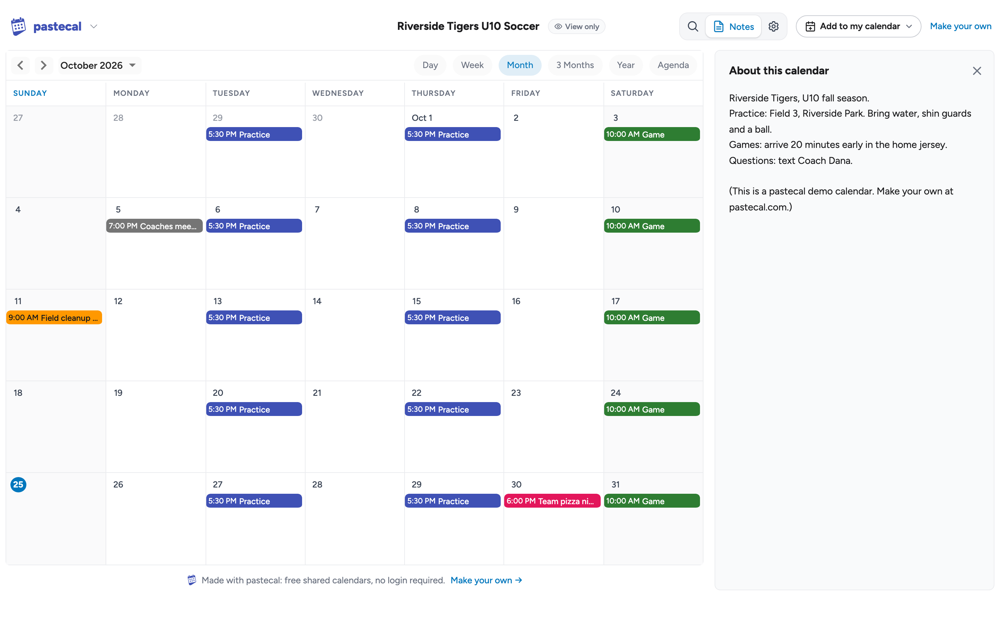
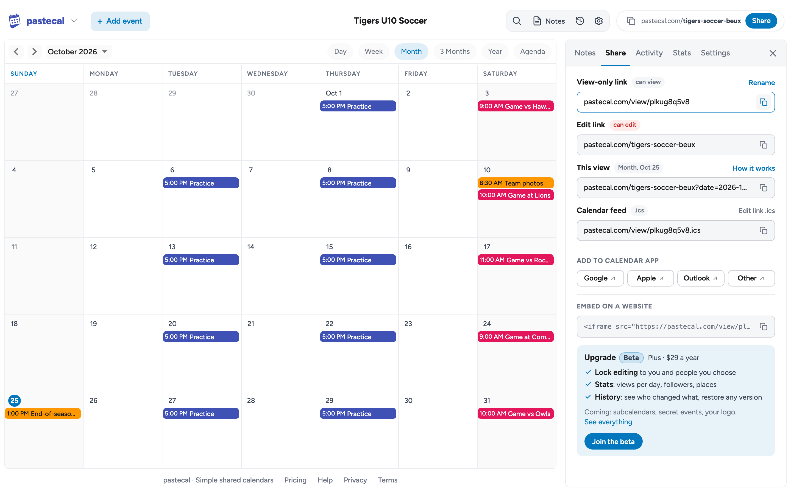
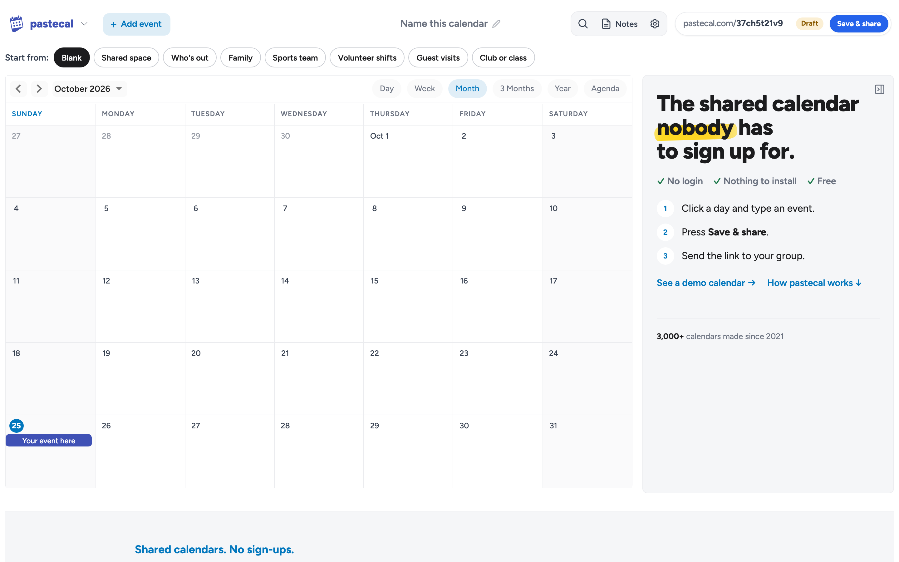

# pastecal

**[pastecal.com](https://pastecal.com): shared calendars. No sign-ups.**

Add events, press Save & share, and send the link. Everyone sees every change in any browser, or in their own calendar app. Nobody needs an account or an app.

## What you can do

- **Make a calendar in seconds.** Click a day and type, or start from a template (sports team, family, volunteer shifts, shared space).
- **Pick a link you'll remember**, like `pastecal.com/soccer-fall`, or keep the random one.
- **Share two ways:** the edit link for helpers, and a view-only link for everyone else.
- **Add it to Google, Apple or Outlook.** Each calendar has a feed (`.ics`) that stays up to date.
- **Embed it** on a website with one `<iframe>`.
- **Undo anything.** Recent changes are listed, and any of them can be put back.
- **Link to a date and view:** `pastecal.com/soccer-fall?date=2026-10-25&view=week` (views: day, week, month, year, agenda).

## Plans

pastecal is free: unlimited calendars and people, no login. Optional upgrades (currently in beta) lock who can edit and add stats and history. See [pricing](https://pastecal.com/pricing).

## How it's built

A small Vue front end on Cloudflare Workers, with each calendar stored in its own Durable Object. Tests: `node --test $(node test/unit-files.js)` for unit tests and `scripts/test-all.sh` for everything else.

## Why it exists

I wanted a link to a calendar that's easy to edit, without logging in or installing anything. It started as an answer to a ViaPrize challenge (and an idea from [what-to-code](https://github.com/joereynolds/what-to-code#websites)). More on the [about page](https://pastecal.com/about).

Feedback, ideas or something broken? Use [GitHub Discussions](https://github.com/kazad/pastecal/discussions) or [pastecal.com/contact](https://pastecal.com/contact).

